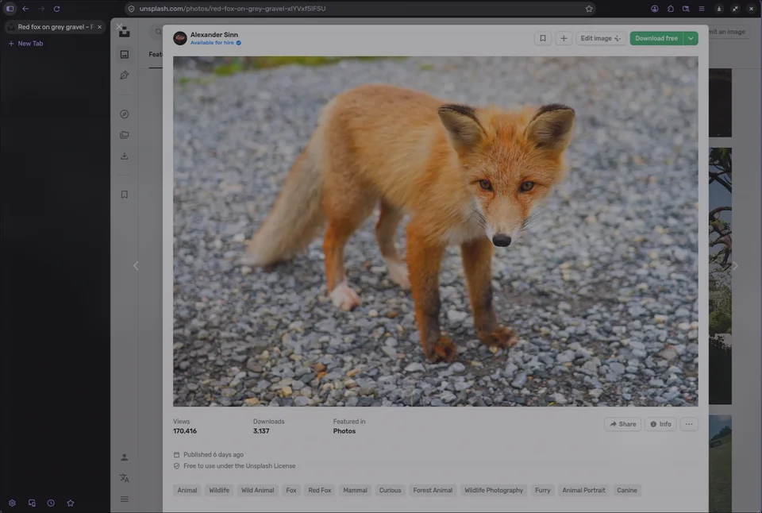
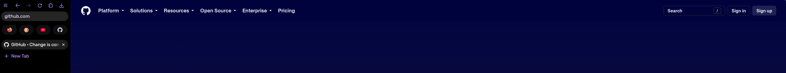
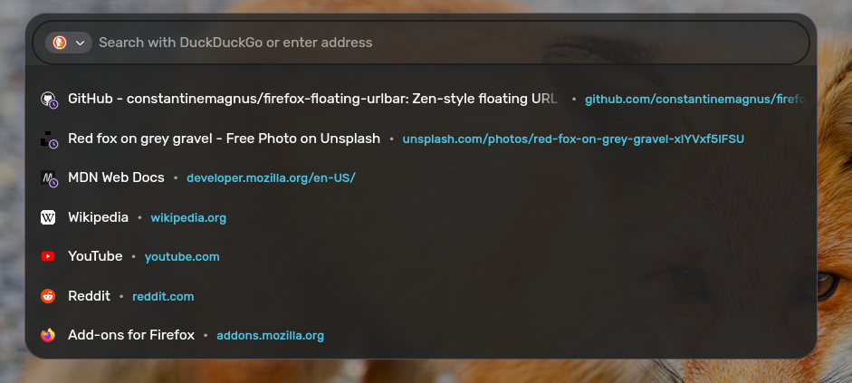

# Firefox Floating URL Bar & Compact Mode

A Zen-style floating URL bar for Firefox, with an optional [compact mode](#compact-mode) for vertical tabs.

- **Floating URL bar:** Ctrl+T opens a centered floating bar without creating a blank tab; Enter opens the URL or search in a new tab. Ctrl+L navigates in the current tab, and Ctrl+K opens centered search.
- **Compact mode:** Puts the address field, menu, and your chosen toolbar buttons above vertical tabs on either side of the window. The remaining toolbar appears on hover at the top edge, leaving more room for the page. It is off by default.

It uses an [fx-autoconfig](https://github.com/MrOtherGuy/fx-autoconfig) user script and a stylesheet. No extension or theme replacement is required.

## Floating URL bar demo

<p align="center">
  
</p>

## Compact mode demo

<p align="center">
  
</p>

## Behaviour

| Action | Result |
| --- | --- |
| Ctrl+T (Cmd+T on macOS) | Centred URL bar; Enter opens the result in a new tab |
| Escape / click away | Cancels floating URL-bar editing, discards what you typed, and restores the current page's address |
| Ctrl+L (Cmd+L on macOS) | Centred URL bar; Enter navigates in the current tab |
| Ctrl+K (Cmd+K on macOS) | Centred search mode; Enter searches in the current tab. Outside compact layout, a separate Firefox search bar keeps native focus behavior |
| Click the normal address field | Uses native editing without centering or dimming; suggestions and search work normally |
| Click inside the floating address field | Keeps the current shortcut's search mode and navigation destination |
| F6 / Alt+D | Normal Firefox behavior; does not open the floating bar |
| `+` button, File → New Tab, Ctrl+N (Cmd+N on macOS) | Opens a normal tab or window without activating the centered bar |

By default, the bar opens and closes without animation and dims the background by 35%. Firefox's suggestion settings are respected; empty centered bars keep the same rounded appearance. The input, suggestions, and menus stay above the dimming.

## Requirements

- Firefox. The installers set up [fx-autoconfig](https://github.com/MrOtherGuy/fx-autoconfig) when needed, or reuse an existing loader.
- CSS anchor positioning support. Without it, the stylesheet has no effect and the bar stays in its normal position.
- Tested on Firefox 157.0.1 on Linux; Windows local install verified. Windows remote install/uninstall and macOS are untested.
- The script uses Firefox's internal URL bar APIs. If required APIs are missing, it logs a warning in the Browser Console and preserves normal Ctrl+T behavior.

> These files run with full browser privileges. Read them before installing.

## Install

### Linux and macOS

Arch users can manage fx-autoconfig with a [local pacman package](packaging/fx-autoconfig/README.md).

One-command:

```bash
bash -c "$(curl -fsSL https://raw.githubusercontent.com/constantinemagnus/firefox-floating-urlbar/main/install-remote.sh)"
```

Or locally:

```bash
git clone https://github.com/constantinemagnus/firefox-floating-urlbar.git
cd firefox-floating-urlbar
./install.sh
```

Options: `--profile /path/to/profile`, `--root DIR`, `--firefox-dir /path/to/firefox` (on macOS usually `/Applications/Firefox.app/Contents/Resources`). Append options to the paste command as `-- --profile /path/to/profile`. First-time setup needs `curl`, `tar`, and `sha256sum` or `shasum`.

### Windows

Local install verified; remote install/uninstall untested.

One-command:

```powershell
powershell -NoProfile -ExecutionPolicy Bypass -Command "irm https://raw.githubusercontent.com/constantinemagnus/firefox-floating-urlbar/main/install-remote.ps1 | iex"
```

Or locally (PowerShell 5.1 or 7) from the extracted folder:

```powershell
powershell -NoProfile -ExecutionPolicy Bypass -File .\install.ps1
```

Options: `-ProfilePath 'C:\path\to\profile'`, `-FirefoxDirectory 'C:\Program Files\Mozilla Firefox'`, `-Uninstall`.

### Notes

- Regular Firefox installs support automatic fx-autoconfig setup; Flatpak/Snap need separate AutoConfig setup first (an existing loader is reused). Existing loaders are preserved.
- Run installers as your normal user; sudo/UAC is requested only for protected Firefox startup-file writes.
- One-command installers fetch current `main` over HTTPS; the fx-autoconfig download is pinned to the commit in `fx-autoconfig.conf` and SHA-256 verified. See [ATTRIBUTION.md](ATTRIBUTION.md).
- Automatic setup adds privileged startup files (`config.js`, `defaults/pref/config-prefs.js`) to Firefox's installation directory (all profiles) and sets `general.config.sandbox_enabled=false` for the AutoConfig sandbox.
- Restart Firefox; if nothing changes, clear the startup cache in `about:support`.

### Manual (any OS)

**Prerequisite:** Install [fx-autoconfig](https://github.com/MrOtherGuy/fx-autoconfig) first; copying these files alone does nothing without it.

Once fx-autoconfig is installed:

1. Open `about:support` in Firefox and locate **Profile Folder** (or **Profile Directory**).
2. Open that folder and copy:
   - `JS/replace-new-tab.uc.js` → `chrome/JS/`
   - `CSS/firefox-floating-urlbar.uc.css` → `chrome/CSS/`
3. In `about:support`, click **Clear startup cache** and confirm the restart.

## Update

One-command reruns fetch current source; ZIP users download/extract the newer ZIP, then rerun the installer with the same profile. Rerunning an old extracted copy does not update project files. For a Git checkout:

```bash
./update.sh
```

Shows incoming commits/files and asks before applying; refuses local edits or a branch ahead of upstream. Options: `--yes`, `--choose`, `--profile`/`--root`. Arch users: see [package update instructions](packaging/fx-autoconfig/README.md#updates-and-removal).

## Uninstall

Locally:

```bash
./uninstall.sh
```

```powershell
powershell -NoProfile -ExecutionPolicy Bypass -File .\install.ps1 -Uninstall
```

One-command:

```bash
bash -c "$(curl -fsSL https://raw.githubusercontent.com/constantinemagnus/firefox-floating-urlbar/main/install-remote.sh)" -- --uninstall
```

```powershell
powershell -NoProfile -ExecutionPolicy Bypass -Command "& ([scriptblock]::Create((irm https://raw.githubusercontent.com/constantinemagnus/firefox-floating-urlbar/main/install-remote.ps1))) -Uninstall"
```

Removes our two files (backs up edited copies); leaves `prefs.js` untouched and keeps shared fx-autoconfig files (remove them separately only if nothing else uses them). Restart Firefox and clear the startup cache if needed. If an older version changed `browser.urlbar.openintab` and you never set it, reset it in `about:config`.

## Preferences (about:config, optional)

Create these preferences as **Boolean** values in `about:config` to override the defaults.

| Preference | Default | Meaning |
| --- | --- | --- |
| `uc.floatingurlbar.enabled` | `true` | Set to `false` to restore native shortcut behavior; appearance preferences remain independent |
| `uc.floatingurlbar.debug` | `false` | Log script activity to the Browser Console (Ctrl+Shift+J) |
| `uc.floatingurlbar.animate` | `false` | CSS-only: enable the 0.3-second position/width animation |
| `uc.floatingurlbar.dim` | `true` | CSS-only: dim the background by 35% while the bar floats |
| `uc.floatingurlbar.glass` | `false` | Experimental, CSS-only: translucent floating input, suggestions, and engine shortcuts with background blur |
| `uc.floatingurlbar.compact` | `false` | Experimental: compact toolbar above expanded vertical tabs |
| `uc.floatingurlbar.compact.pins.manual` | `false` | Use Firefox's native pinned-tab height and resize handle instead of fitting rows automatically in compact mode |

The system's reduced-motion preference always disables animation. The optional animation is best suited to the normal toolbar layout.

To adjust dimming, change `--floatingurlbar-dim-opacity` in `CSS/firefox-floating-urlbar.uc.css` or override it in `userChrome.css`:

```css
:root {
    --floatingurlbar-dim-opacity: 0.35 !important;
}
```

Use a number from `0` to `1` (opaque black). For `userChrome.css` to work, enable `toolkit.legacyUserProfileCustomizations.stylesheets`. Restart Firefox and clear the startup cache after stylesheet changes.

### Optional glass appearance

Set `uc.floatingurlbar.glass` to `true` in `about:config` for the translucent appearance.

<p align="center">
  
</p>

## Compact mode

Set `uc.floatingurlbar.compact` to `true` to put the address field and menu above expanded vertical tabs on either side. Collapsed sidebars, horizontal tabs, fullscreen and toolbar customization use the normal layout.

In **Customize Toolbar**, move buttons (including pinned extensions) before the address field to show them in the compact header. Other buttons stay in the toolbar revealed by hovering near the top edge. The native **Extensions** button joins the header unless hidden in Firefox's settings; unpinned extensions remain available in its panel. The overflow button is hidden.

Click the address field to expand it beside the sidebar and navigate in the current tab; click empty sidebar space to dismiss editing. Ctrl+T, Ctrl+L and Ctrl+K use the centered bar. In compact mode, Ctrl+K uses URL-bar search even if a separate search bar is configured.

Use the centered bar to change search engines or access site information and permissions, including warnings and sharing indicators; these controls are hidden in the sidebar field. Selected engines remain active. Right-side controls appear on hover or focus and while their popup is open.

Pinned tabs resize automatically, scrolling at 40% of the window height. Set `uc.floatingurlbar.compact.pins.manual` to `true` to use Firefox's saved height and resize handle instead.

Hover near the top edge to reveal the remaining toolbar and window controls. On Windows and Linux, a right-hand sidebar moves window controls to the left; macOS keeps native placement.

## Other URL bar tweaks

Other URL bar customizations may conflict with this stylesheet. Disable conflicting rules if the floating bar displays incorrectly.

## Troubleshooting

- Nothing changed after installing: clear the startup cache (`about:support` → **Clear startup cache**) and restart Firefox. Check that fx-autoconfig is installed correctly.
- Ctrl+T behaves normally or Enter opens in the current tab: enable debug logging as described below.
- The bar isn't centred: disable conflicting URL bar tweaks. If that does not help, open an issue with your Firefox version.

To debug, set `uc.floatingurlbar.debug` to `true` in `about:config`, restart Firefox, and open the Browser Console (Ctrl+Shift+J). Include the script's messages and your Firefox version when opening an issue.

## Development checks

```bash
node --test tests/urlbar.test.cjs
bash tests/shell.test.sh
pwsh -NoProfile -File tests/powershell.test.ps1
```

Tests use mocks and temporary files. The PowerShell suite requires PowerShell and uses symbolic links; on Windows it needs Developer Mode or administrator rights for those fixtures. Visual changes and platform-specific elevation still require testing in Firefox on each OS.

## License and attribution

Project code and original documentation are licensed under [MIT](LICENSE). The new-tab replacement was originally adapted from [Natsumi Browser](https://github.com/greeeen-dev/natsumi-browser) (source file: MIT), and the centered URL-bar CSS was adapted from [FlexFox](https://github.com/yuuqilin/FlexFox) (MIT).

[fx-autoconfig](https://github.com/MrOtherGuy/fx-autoconfig) by MrOtherGuy remains under MPL-2.0. Standalone installs keep its license and pinned source URL in `chrome/utils/fx-autoconfig.LICENSE` and `chrome/utils/fx-autoconfig.txt`; the Arch package includes them under `/usr/share/licenses/fx-autoconfig/` and `/usr/share/doc/fx-autoconfig/`. See [ATTRIBUTION.md](ATTRIBUTION.md) for full notices.

Third-party imagery, website content, logos, and trademarks shown in the demo captures retain their respective rights and are not covered by the project's MIT license. See [ATTRIBUTION.md](ATTRIBUTION.md#demo-imagery-and-website-content).
