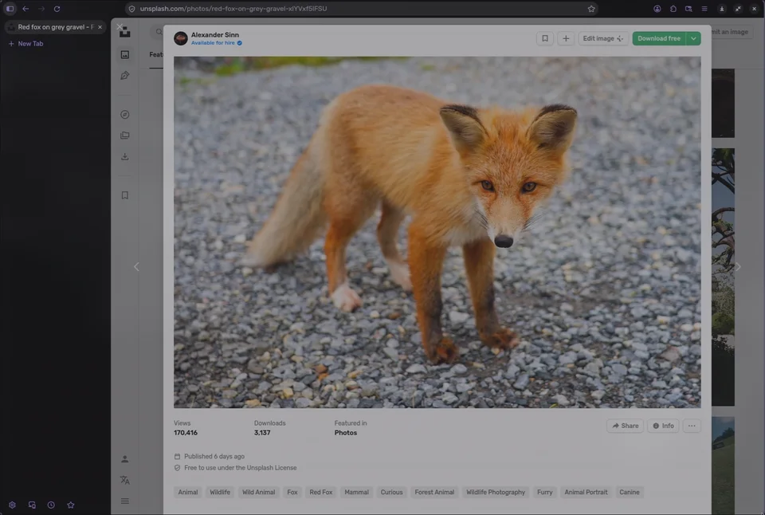
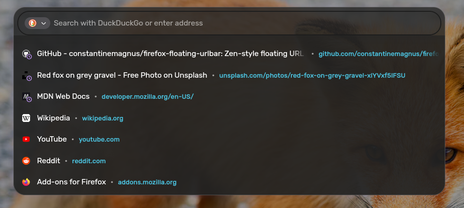
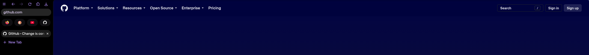

# Firefox Floating URL Bar

A Zen-style floating URL bar for Firefox, with an optional compact vertical-tab mode.

- **Ctrl+T** opens a centered URL bar and opens the result in a new tab.
- **Ctrl+L** opens the same bar to navigate in the current tab.
- **Ctrl+K** opens centered search.
- **Compact mode** (optional) places the address field, toolbar buttons, and pinned extensions above Firefox's vertical tabs.

Built as a single [fx-autoconfig](https://github.com/MrOtherGuy/fx-autoconfig) script and stylesheet, with no extension or full browser theme required.

<p align="center">
  
</p>

## Behavior

| Action | Default behavior |
| --- | --- |
| Ctrl+T | Centered URL bar; Enter opens in a new tab (reuses an empty tab) |
| Ctrl+L | Centered URL bar; Enter navigates in the current tab |
| Ctrl+K | Centered search in the current tab (a separate search bar stays native outside compact mode) |
| Escape / click away | Cancels editing and restores the current page URL |
| Click the address field | Native Firefox editing (or centered in the current tab when `uc.floatingurlbar.float-on-click` is enabled) |
| F6 / Alt+D | Native Firefox behavior |
| `+`, File → New Tab, Ctrl+N / Cmd+N | Native new tab or window |

On macOS, use **Cmd** instead of **Ctrl**. Firefox's own suggestion, search-engine, and shortcut settings are respected.

## Requirements

- **Firefox 157+** (requires CSS anchor positioning and Firefox's split-popover URL bar; older releases and ESR are unsupported).
- **[fx-autoconfig](https://github.com/MrOtherGuy/fx-autoconfig)** (installed automatically for regular Firefox installs; existing loaders are reused).

Sandboxed installs (**Flatpak**, **Snap**, and **Microsoft Store (`WindowsApps`)**) keep Firefox's installation directory read-only, so automatic first-time AutoConfig setup isn't supported there. Set up AutoConfig separately first, then run the installer.

> **Security note:** `fx-autoconfig` scripts run with full browser privileges. Review the files before installing.

## Install

The installer copies the script and stylesheet into your chosen Firefox profile. If `fx-autoconfig` isn't already installed, it also installs the shared startup files and disables the AutoConfig sandbox (`general.config.sandbox_enabled=false`), which applies to **all profiles using that Firefox installation**.

Run installers as your normal user. `sudo` or UAC is requested only when protected Firefox installation files need to be written.

One-command installs download the latest `main` archive over HTTPS and trust this repository and GitHub. To review before running, use a local Git checkout or a tagged archive from [GitHub Releases](https://github.com/constantinemagnus/firefox-floating-urlbar/releases) (verified against `SHA256SUMS`).

### Linux / macOS

One-command install:

```bash
installer=$(curl -fsSL https://raw.githubusercontent.com/constantinemagnus/firefox-floating-urlbar/main/install-remote.sh) && bash -c "$installer"
```

Or install from a local clone or extracted release archive:

```bash
git clone https://github.com/constantinemagnus/firefox-floating-urlbar.git
cd firefox-floating-urlbar
./install.sh
```

Useful options:

```text
--profile DIR      Target a specific profile folder (skips the prompt)
--firefox-dir DIR  Firefox install directory (macOS: /Applications/Firefox.app/Contents/Resources)
--root DIR         Folder containing profiles.ini
```

Arch Linux users who prefer package-managed startup files can build the [local `fx-autoconfig` package](packaging/fx-autoconfig/README.md) first, then run `./install.sh`.

### Windows

One-command install:

```powershell
powershell -NoProfile -ExecutionPolicy Bypass -Command "& ([scriptblock]::Create((irm -ErrorAction Stop https://raw.githubusercontent.com/constantinemagnus/firefox-floating-urlbar/main/install-remote.ps1)))"
```

Or run locally from a checkout or extracted release ZIP:

```powershell
powershell -NoProfile -ExecutionPolicy Bypass -File .\install.ps1
```

Useful options:

```text
-ProfilePath 'C:\path\to\profile'
-FirefoxDirectory 'C:\Program Files\Mozilla Firefox'
-Root 'C:\path\to\profiles-root'
```

### Manual install

Install [fx-autoconfig](https://github.com/MrOtherGuy/fx-autoconfig) first, then:

1. Open `about:support` and open your **Profile Folder** / **Profile Directory**.
2. Copy:
   - `JS/replace-new-tab.uc.js` → `chrome/JS/`
   - `CSS/firefox-floating-urlbar.uc.css` → `chrome/CSS/`
3. In `about:support`, click **Clear startup cache** and restart Firefox.

### After installing

Restart Firefox. When Firefox is closed during installation, the installer clears the startup cache automatically; if changes still don't appear, open `about:support` and click **Clear startup cache**.

## Update

From a Git checkout:

```bash
./update.sh
```

`update.sh` previews incoming commits and changed files before applying anything, and refuses to overwrite local Git edits. Pass `--choose` to pick a different profile or `--yes` to skip confirmation.

For one-command or release-archive installs, rerun the newer installer.

## Uninstall

From a local checkout or extracted release archive:

```bash
# Linux / macOS
./uninstall.sh
```

```powershell
# Windows
powershell -NoProfile -ExecutionPolicy Bypass -File .\install.ps1 -Uninstall
```

Using the one-command scripts:

```bash
# Linux / macOS
installer=$(curl -fsSL https://raw.githubusercontent.com/constantinemagnus/firefox-floating-urlbar/main/install-remote.sh) && bash -c "$installer" -- --uninstall
```

```powershell
# Windows
powershell -NoProfile -ExecutionPolicy Bypass -Command "& ([scriptblock]::Create((irm -ErrorAction Stop https://raw.githubusercontent.com/constantinemagnus/firefox-floating-urlbar/main/install-remote.ps1))) -Uninstall"
```

By default, uninstall removes only this project's script and stylesheet (keeping a timestamped backup if you edited them). To also remove `fx-autoconfig` files installed by this project, pass the flags below (they can also be appended to the one-command uninstallers):

| Cleanup | Bash | PowerShell |
| --- | --- | --- |
| Remove profile loader too | `--remove-autoconfig` | `-RemoveAutoconfig` |
| Remove shared startup files too | `--remove-shared-autoconfig --firefox-dir DIR` | `-RemoveSharedAutoconfig -FirefoxDirectory DIR` |

Cleanup removes only files created by this project and stops if other scripts or styles in the profile still need the loader. Removing shared startup files disables AutoConfig for **all profiles using that Firefox installation**.

## Configuration

Create any of these as **Boolean** preferences in `about:config`:

| Preference | Default | Effect |
| --- | --- | --- |
| `uc.floatingurlbar.enabled` | `true` | Master switch for the script and stylesheet |
| `uc.floatingurlbar.float-on-click` | `false` | Also float the URL bar when clicking the address field (navigates in the current tab) |
| `uc.floatingurlbar.dim` | `true` | Dim the page behind the floating URL bar |
| `uc.floatingurlbar.glass` | `false` | Experimental translucent appearance |
| `uc.floatingurlbar.compact` | `false` | Move the address field and buttons above vertical tabs |
| `uc.floatingurlbar.compact.hover-reveal` | `true` | Hover the top edge in compact mode to reveal the top toolbar when something remains on it (bookmarks, wide widgets, or top window controls). Set to `false` for click-only reveal (F10/Alt still work). |
| `uc.floatingurlbar.compact.pins.manual` | `false` | Use Firefox's native pinned-tab height and resize handle in compact mode |
| `uc.floatingurlbar.debug` | `false` | Log events and hook state to the Browser Console (`Ctrl+Shift+J`) |

### Appearance tweaks

You can override the dimming opacity in your profile's `chrome/userChrome.css`:

```css
:root {
    --floatingurlbar-dim-opacity: 0.35 !important;
}
```

For `userChrome.css` to load, enable `toolkit.legacyUserProfileCustomizations.stylesheets` in `about:config`, then clear the startup cache and restart Firefox.

### Glass appearance

Set `uc.floatingurlbar.glass = true`:

<p align="center">
  
</p>

## Compact mode

Set `uc.floatingurlbar.compact = true`, turn on **expanded vertical tabs** (left or right side), and turn off Firefox's sidebar **expand on hover** setting.

<p align="center">
  
</p>

- **Header buttons:** Visible toolbar buttons, pinned extensions, and the overflow (`»`) menu automatically appear in the compact header. Use **Customize Toolbar** to reorder or remove buttons; wide widgets (such as zoom or edit controls) remain on the revealed top toolbar.
- **Address field:** Click the sidebar address field to expand and edit in the current tab (or float centered if `uc.floatingurlbar.float-on-click` is enabled). `Ctrl+T`, `Ctrl+L`, and `Ctrl+K` always open the centered bar.
- **Site controls:** Search engines, site info, permissions, and sharing controls remain available from the centered bar.
- **Top toolbar:** Disabled (with no hover trigger) when all buttons and window controls fit in the sidebar header and nothing remains at the top. If you have bookmarks on the Bookmarks Toolbar, wide widgets, or top window controls (on macOS or narrow sidebars), rest the pointer at the top edge or click it to reveal the toolbar. Set `uc.floatingurlbar.compact.hover-reveal = false` for click-only reveal.
- **Window dragging & menubar:** Drag empty header, toolbar, or vertical-tab space. Press `F10` or `Alt` to access the native menubar on Windows/Linux.
- **Pinned tabs:** Rows fit their contents automatically. Set `uc.floatingurlbar.compact.pins.manual = true` to restore Firefox's manual resize handle.

Collapsed sidebars, horizontal tabs, fullscreen, and **Customize Toolbar** automatically fall back to Firefox's normal layout.

## Troubleshooting

**Nothing changed after installing**
Open `about:support`, click **Clear startup cache**, and restart Firefox.

**Ctrl+T opens a normal tab, or navigation goes to the wrong tab**
Set `uc.floatingurlbar.debug = true`, restart Firefox, and inspect the Browser Console (`Ctrl+Shift+J`).

**The bar looks misaligned or isn't centered**
Disable other URL-bar or toolbar CSS/scripts that may conflict, and confirm you're on a supported Firefox version (157+).

**"Another AutoConfig configuration exists" (LibreWolf and similar)**
Some forks ship their own AutoConfig, which the installer won't overwrite. Follow [fx-autoconfig's instructions](https://github.com/MrOtherGuy/fx-autoconfig) to integrate the loader, then rerun the installer with `--profile` (`-ProfilePath` on Windows) to reuse the existing loader.

**Flatpak, Snap, or Microsoft Store Firefox**
These packages make Firefox's program directory read-only. Install AutoConfig separately (or use regular Firefox), then rerun the installer.

When reporting an issue, include your OS, Firefox version, enabled `uc.floatingurlbar.*` preferences, and any Browser Console messages.

## Development

Run the local checks and regression suites:

```bash
node --check JS/replace-new-tab.uc.js
shellcheck -x install.sh update.sh uninstall.sh lib.sh autoconfig.sh install-remote.sh packaging/build-installers.sh
bash tests/run.sh
pwsh -NoProfile -File tests/powershell.test.ps1
bash tests/macos.test.sh  # native macOS only
```

CI runs across Linux, Windows (PowerShell 5.1 and 7), and macOS (x86_64 and arm64). Because the JavaScript tests mock Firefox internals, visual layout, native keyboard/IME handling, window dragging, and OS elevation prompts still require manual testing in Firefox.

## License and attribution

Project code and original documentation are licensed under the [MIT License](LICENSE).

- New-tab replacement originally adapted from [Natsumi Browser](https://github.com/greeeen-dev/natsumi-browser) (MIT).
- Centered URL-bar and backdrop dimming CSS adapted from [FlexFox](https://github.com/yuuqilin/FlexFox) (MIT).
- [fx-autoconfig](https://github.com/MrOtherGuy/fx-autoconfig) by MrOtherGuy is licensed under MPL-2.0. See [ATTRIBUTION.md](ATTRIBUTION.md) for full notices.

Third-party imagery, website content, logos, and trademarks shown in demo captures retain their respective rights and are not covered by this project's MIT license.
